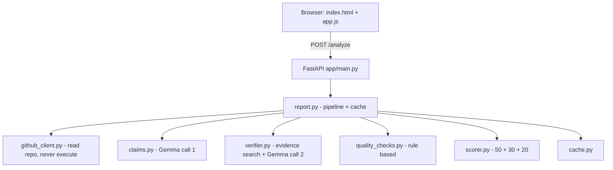

# RepoJudge

**Judge any public GitHub repository fairly, with proof.**

RepoJudge takes a public GitHub repository URL. It reads the README and the
code, finds the claims the project makes, looks for proof of each claim in the
code, runs general engineering quality checks, and produces a score sheet.
Anything it cannot prove is reported as **Unverified**. It never guesses.

Every score and every status comes with evidence: a file path, a line number
and a short snippet, or an explicit "no evidence found".

---

## Why it exists

Reading a repository to judge it properly takes a long time. Most of us skim
the README, believe the feature list, and move on. RepoJudge turns that skim
into a repeatable, evidence-backed review:

- It separates what a project **claims** from what the code actually **shows**.
- It never rewards a project for a claim it cannot back up.
- It shows exactly where the evidence is, so you can check it yourself.

## Who can use it

- **Judges** who need a fast, fair first pass over many project submissions.
- **Hiring managers** reviewing a candidate's project before an interview.
- **Teachers** giving students structured feedback on a project.
- **Students** checking their own work before submitting it.
- **Open-source maintainers** auditing their own README claims.

RepoJudge is a general-purpose tool. It contains no event-specific,
competition-specific or category-specific logic anywhere in its code, text or
interface.

---

## How Gemma is used

RepoJudge uses **Gemma**, Google's open model family, served through the
**Gemini API**. The model is used for exactly two things per analysis:

1. **Extracting claims** - reading the README and listing the concrete,
   checkable claims the project makes, each with search `keywords`, **strong
   keywords** (the specific technical terms that would have to appear in the code
   if the claim were true) and an `evidence_kind` (`functional` or
   `presentation`).
2. **Judging claims** - given each claim and the evidence lines found in the
   code, answering `supports` (`full`, `part` or `none`), the exact `proof`
   (`file:line` from that claim's evidence, or `null`) and a short `reason`.
   The code then turns that into `Verified`, `Partial` or `Unverified`.

The model name is configured in [`app/config.py`](app/config.py) as
`GEMMA_MODEL`, and defaults to **`gemma-4-26b-a4b-it`** (a smaller, faster
Gemma model). You can override it with the `GEMMA_MODEL` environment variable.

Replies are kept short and machine-readable on purpose:

- Gemma is asked for compact JSON only, with each reason at most 15 words and
  each claim at most 12 words, and `maxOutputTokens` is capped
  (`GEMMA_MAX_OUTPUT_TOKENS`, 2048 by default).
- The request also asks the API to constrain the reply to a JSON schema
  (`responseSchema`), because some Gemma variants narrate their reasoning before
  answering. The claims call runs cold (`GEMMA_CLAIMS_TEMPERATURE`, 0.0 by
  default) so the same repository gives the same claims every time; a slightly
  non-zero `temperature` (0.3) for judging plus `topK`/`topP` keeps the model
  from falling into repetition loops that used to eat the whole token budget.
- RepoJudge also asks for a low thinking level when the model supports it.

If the model or API rejects any of these optional settings (`thinkingConfig` /
`responseSchema`), RepoJudge drops that setting automatically and retries, so it
still works with models that do not support them.

Two important details:

- **RepoJudge never lets the model do the searching.** Keyword search for
  evidence is plain Python. Gemma only reads the evidence it is given, and the
  judge prompt spells out that a mock, fake, demo or hard-coded list is not a
  real database, API or feature, that a comment or a CSS rule proves nothing
  about a library or a test, and that it must answer "none" when the evidence
  does not show the claim.
- **The model cannot override the evidence rules.** If a claim has no qualifying
  evidence, or none of its strong keywords appear anywhere in the code, its
  status is forced to `Unverified` in code, whatever Gemma says. Strong keywords
  are matched tolerantly - case, spaces, dots, dashes, underscores, camelCase,
  plurals and a redundant `js`/`api` suffix - so a library written `Chart.js` is
  still found as `new Chart(` and a joined term like `webspeechapi` still finds
  `speechSynthesis`. Only when that whole pass finds nothing is a second pass
  made over the claim's own words and ordinary keywords, so a long or joined
  strong keyword from the model cannot sink a claim that is really implemented.

All other checks (engineering quality, repository health, scoring) are
rule-based and use no LLM at all.

---

## Architecture

```
Browser (static/index.html + app.js)
        |
        |  POST /analyze  { repo_url, requirements, nocache }
        v
FastAPI  (app/main.py)
        |
        v
app/report.py  -- orchestrates the pipeline and caches the result
        |
        +--> app/github_client.py   reads the repo (README, tree, languages,
        |                           license, commits, important file contents)
        |                           READ ONLY - never executes repo code
        |
        +--> app/claims.py          Gemma call 1 -> claims + keywords
        |                           + strong keywords + evidence kind
        |
        +--> app/verifier.py        keyword search for evidence (no LLM)
        |                           Gemma calls 2+ -> supports/proof/reason,
        |                           in batches of 8 plus one retry, then a
        |                           consistency re-check of matching proof lines
        |                           then enforces: no proof => Unverified,
        |                           no judgement => Not judged (never guessed)
        |
        +--> app/quality_checks.py  rule-based engineering checks (no LLM)
        |
        +--> app/scorer.py          claims 50 + quality 30 + health 20 = 100
        |
        +--> app/cache.py           file cache keyed by repo + commit + requirements
```

Mermaid version:



---

## Setup

Requires **Python 3.11 or newer**.

```bash
# 1. Create and activate a virtual environment
python -m venv .venv
# Windows
.venv\Scripts\activate
# macOS / Linux
source .venv/bin/activate

# 2. Install dependencies
pip install -r requirements.txt

# 3. Configure secrets: copy the template and fill it in.
#    RepoJudge loads this .env automatically on startup.
cp .env.example .env        # then edit .env

# 4. Run the server
uvicorn app.main:app --reload --port 8000
```

Then open <http://localhost:8000>.

### Required environment variables

| Variable | Required | Purpose |
| --- | --- | --- |
| `GEMINI_API_KEY` | Yes | Lets RepoJudge call Gemma through the Gemini API. |
| `GITHUB_TOKEN` | No, but recommended | Raises the GitHub rate limit from 60 to 5000 requests/hour. |
| `GEMMA_MODEL` | No | Overrides the Gemma model name. |
| `REPOJUDGE_MAX_TOTAL_FILE_BYTES` | No | Total source budget to read per repository (300 KB by default). |
| `REPOJUDGE_MAX_SINGLE_FILE_BYTES` | No | Bytes kept from any one file before its keyword lines are added back (64 KB by default). |
| `GEMMA_TIMEOUT_SECONDS` | No | Seconds to wait for a Gemma call (300 by default). |

RepoJudge never hardcodes keys. Everything is read from the environment, and
`.env` is listed in `.gitignore`. If a `.env` file exists next to `config.py`,
RepoJudge loads it automatically; real environment variables always take
priority over the file.

---

## Supported repository types (version 1)

- **FULL analysis**: public repos whose main language is Python or
  JavaScript/TypeScript, with a README.
- **LIMITED analysis**: any other language. RepoJudge does README claims, repo
  health and license only. A banner is shown:
  *"Limited analysis: code checks are not available for this language"*.
  Code-based claims are `Unverified`, and code-based quality checks are shown
  as `Not checked` (they never lower the score).
- **NOT supported**: private repos, repos with no README (RepoJudge stops with
  a clear message), and running the project.

**Big repositories.** RepoJudge reads every readable source file up to a total
budget of about 300 KB (`REPOJUDGE_MAX_TOTAL_FILE_BYTES`), preferring main entry
files, `src` folders, and the files the README names or lists in its project
structure. It always reads `index.html` and the README. Files it skips are
images, lockfiles, minified bundles, `node_modules`, `dist`, `build`, `.git`,
and other machine-generated output.

A very large source file is not skipped: RepoJudge keeps its first
`REPOJUDGE_MAX_SINGLE_FILE_BYTES` bytes and then goes back for the lines that
match a claim keyword, so evidence can still point at the real line. The report
always lists which files were read and which were skipped, with the reason for
each one.

**Main language** is detected from the GitHub languages API.

---

## How scoring works

The score is out of **100** and is split three ways:

- **Claims - 50 points.** `Verified` earns full points, `Partial` half,
  `Unverified` zero. A `Not judged` claim is left out of the total.
- **Engineering quality - 30 points.** Split across the rule-based engineering
  checks. A check that was not run or does not apply never lowers the score.
- **Repository health - 20 points.** License, commit history, recent activity and
  a README.

A repository is never rewarded for a claim it cannot prove, and a check that
could not be run is never counted against it.

## Scoring

The total is out of **100**:

| Part | Points | How it is earned |
| --- | --- | --- |
| Claims | 50 | `Verified` = full, `Partial` = half, `Unverified` = 0, spread evenly across the judged claims (including your extra requirements). A `Not judged` claim is left out of the total. |
| Engineering quality | 30 | Split across nine rule-based checks (tests, setup, dependencies, secrets, .gitignore, structure, documentation, error handling, CI). |
| Repository health | 20 | License present, commit history, recent activity, README present. |

Fairness rules are enforced in code:

- A claim with no qualifying evidence is always `Unverified`.
- A strong keyword (a library, package, driver, import, API call or file the
  claim needs) that appears nowhere in the code also forces `Unverified`,
  whatever the model says. Strong keywords are matched with tolerant variants
  (case, separators, camelCase, plurals, a `js`/`api` suffix), and if none of
  them is found, RepoJudge makes one second pass over the claim's own nouns and
  ordinary keywords before giving up - so a long or oddly spelled strong keyword
  does not hide a real implementation.
- The model must point at a real `file:line` from that claim's evidence to earn
  `Verified`. A `proof` that is not in the evidence, or a verdict of "none",
  becomes `Unverified`. `Unverified` always means "no proof was found in the code
  read", and it never shows unrelated evidence.
- A claim the model never judged is `Not judged`, is shown clearly, and is left
  out of the claims score entirely - it is never counted as `Partial`.
- A reason may only name files that appear in that claim's evidence.
- A check that could not be run is `Not checked` and **never lowers the score**.
- A check that does not apply (for example a dependency file for a plain HTML/JS
  site that loads its libraries from a CDN) is `Not applicable` and never lowers
  the score.
- Continuous integration is a **bonus**: if a repo has no CI configuration the
  check reads `Not checked (bonus)` and never costs points.

---

## API

### `POST /analyze`

```json
{
  "repo_url": "https://github.com/owner/repo",
  "requirements": ["optional extra thing to check", "..."],
  "nocache": false
}
```

`requirements` is optional. It accepts a list of strings or one string with one
item per line. `nocache` is optional: set it to `true` (or tick **Re-run without
cache** on the website) to ignore every cached result - the report, the claims
and the judging - and run the whole analysis again. Returns the full report JSON.

### `GET /report/{id}/markdown`

Returns the same report as Markdown. The `id` is the `id` field from a report.

### `GET /health`

Returns `{"status": "ok", ...}`.

Errors are always clean JSON:

```json
{ "error": { "code": "no_readme", "message": "..." } }
```

Possible codes include `invalid_url`, `repo_not_found`, `private_repo`,
`no_readme`, `github_rate_limit`, `gemma_unavailable`, `gemma_rate_limit` and
`gemma_bad_response`.

---

## Limits and design decisions

- **At most 6 Gemma calls per analysis**: one to extract the claims, then the
  claims are judged in batches of at most **8 per call** (so a long reply can
  never be cut off), plus **one extra call with only the claims the model left
  out**, plus at most one call to re-judge claims whose evidence was filled in
  from another claim's proof. Claim counts stay small on purpose, to respect the
  Gemma free tier of roughly 15 requests per minute.
- **Never guessed**: if a claim is still missing after that extra call, it is
  reported as `Not judged` and left out of the claims score instead of being
  guessed at as `Partial`.
- **What counts as proof**: only code, test, markup and configuration files can
  prove a feature, library, API, database, test suite or platform claim. A
  stylesheet, a document, a lockfile or a comment-only line can only prove a
  claim about styling, layout or documentation.
- **Rate limits**: on an HTTP 429, RepoJudge waits and retries up to 3 times and
  tells you clearly what is happening in the response.
- **Timeouts**: RepoJudge waits up to `GEMMA_TIMEOUT_SECONDS` (300 by default)
  for a reply. If Gemma times out, it retries once and then tells you clearly
  that the model is being slow and that you can try again.
- **JSON only**: Gemma is asked for JSON only. Replies are parsed safely. If a
  reply is not valid JSON, RepoJudge retries once, then returns a clear error.
- **Caching**: results are cached in `./cache`, keyed by repository URL + latest
  commit + the extra requirements text. A changed repo or changed requirements
  always produces a fresh analysis.
- **Read-only**: RepoJudge **never runs or executes code** from a judged
  repository. Files are fetched as text and treated as untrusted strings.
- **Unverified means unproven, not false**: RepoJudge searches the code it reads
  for evidence. Unverified means no proof was found, not that the claim is false.
  Always check important results by hand.
- **What RepoJudge reads**: public repositories on `github.com` only. It gives a
  **full analysis for Python and JavaScript/TypeScript** projects, and a limited
  README-only analysis for every other language.
- **It never runs repository code.** Every file is fetched as text and treated as
  an untrusted string.
- **Gemma dependency**: claim extraction and judging use **Gemma** (the model is
  named in `app/config.py`, default `gemma-4-26b-a4b-it`) through the **Gemini
  API**. Gemma free-tier limits can slow it down: you may see rate-limit or
  timeout messages, and the analysis can take a while.
- Up to **15 claims** per analysis.

---

## Running the tests

```bash
pytest
```

The test suite mocks both the GitHub API and Gemma, so it runs offline and needs
no API keys. It includes:

- unit tests for the GitHub client and its file-selection rules
- tests for claim extraction, evidence search and judging
- tests for the strictness rules: a mock list is not a database, a tests claim
  needs a real test file, a mobile claim needs platform files, a stylesheet alone
  cannot prove a library, a library loaded from a CDN tag in an HTML file can be
  proved, and a skipped judgement becomes `Not judged` without affecting the score
- tests for every engineering quality check, including a hardcoded-secret case
- scoring tests, including proof that "Not checked" never lowers the score
- API tests for every route and error type
- an end-to-end test on `demo/fake_repo`, where a README makes 3 true claims and
  2 false ones, and the false claims must end up `Unverified` even when the model
  insists every claim is fully supported

---

## Demo script

A short, five-minute demo:

1. Start the app (`uvicorn app.main:app --reload --port 8000`) and open
   <http://localhost:8000>.
2. Paste a small public GitHub repository URL and press **Analyze**.
3. Walk through the score (claims 50 / quality 30 / health 20), the Claims table,
   and the `file:line` proof shown for every row.
4. Add an extra requirement the project does not implement (for example
   `Has a mobile app for Android`), analyze again, and show that it is
   **Unverified (no proof found in the code read)** while the real claims stay
   `Verified` or `Partial`.
5. Tick **Re-run without cache** and analyze once more: the same repository gives
   the same claims and statuses.
6. For an offline demo, run `pytest tests/test_demo_pipeline.py`. It uses the
   local `demo/fake_repo`, whose README makes 3 true claims and 2 false ones.

---

## Optional: n8n automation

[`n8n/repojudge.json`](n8n/repojudge.json) is an importable n8n workflow. It is
entirely optional - the website works without it.

The workflow is:

```
Webhook -> HTTP Request (POST /analyze) -> Format summary -> Telegram or email
```

The "Format summary" node builds a short message with the score, the top 3
`Verified` claims and the top 3 `Unverified` claims.

### Importing it

1. Start RepoJudge first (`uvicorn app.main:app --port 8000`).
2. In n8n, open **Workflows -> Import from File** and choose
   `n8n/repojudge.json`.
3. Open the **Analyze repo** node and change the URL if RepoJudge is not running
   on `http://localhost:8000`.
4. **Set your own credentials.** Nothing is shared with this file:
   - **Telegram**: add a Telegram credential and replace
     `REPLACE_WITH_YOUR_CHAT_ID`.
   - **Email** (alternative): the email node is disabled by default. Enable it,
     disable the Telegram node, add an SMTP credential, and replace the
     `REPLACE_WITH_...@example.com` addresses.
5. Activate the workflow, then POST to the webhook:

```bash
curl -X POST http://localhost:5678/webhook/repojudge \
  -H "Content-Type: application/json" \
  -d '{"repo_url": "https://github.com/owner/repo", "requirements": ["Has a CLI"]}'
```

---

## Project layout

```
repojudge/
  app/
    main.py            FastAPI app, routes, serves the frontend
    config.py          model name, limits, file caps
    errors.py          error types that map to clean JSON responses
    github_client.py   README, tree, languages, license, commits, file contents
    gemma_client.py    Gemma HTTP client, JSON parsing, retry behaviour
    claims.py          Gemma call 1: extract claims from the README
    verifier.py        evidence search + Gemma call 2: judge all claims
    quality_checks.py  rule-based engineering checks (no LLM)
    scorer.py          final score and breakdown
    cache.py           simple file cache
    report.py          build the report, export JSON and Markdown
  static/              index.html, style.css, app.js
  n8n/repojudge.json   optional importable n8n automation workflow
  demo/fake_repo/      small fake sample repo for testing
  tests/               pytest tests with mocked GitHub and Gemma responses
```

---

## License

[MIT](LICENSE).
